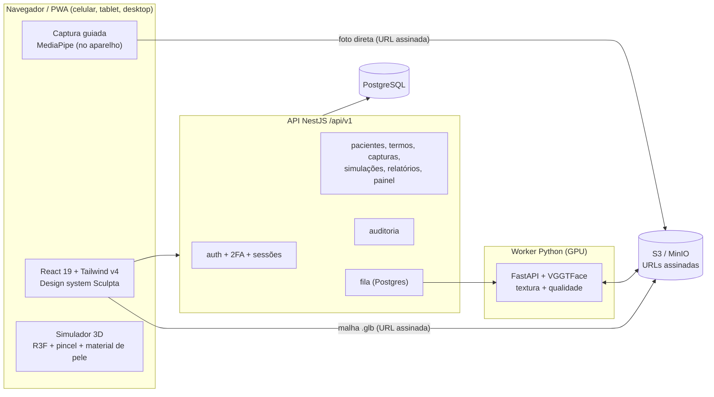

# Sculpta — Guia de reformulação do app

> Versão 0.1 · 18/11/2026 · Autor: Lucas Farias (com Claude) · Status: **etapa 0 concluída; etapa 1 em andamento; etapa 1 e etapa 1B concluídas na versão atual (ver as seções de cada etapa); etapas 2 a 7 em andamento**
> Este guia junta quatro frentes numa só ordem de trabalho: **(1)** a nova marca e o visual corporativo, **(2)** a captura guiada com foto automática e vídeo, **(3)** o realismo do rosto (pele, olhos, cabelo) e a modelagem com caneta, **(4)** contas, clínicas e permissões (multi-clínica, banco real no Supabase, detalhado em [`CONTAS-CLINICAS-PERMISSOES.md`](CONTAS-CLINICAS-PERMISSOES.md)), **(5)** o back-end de produto (relatórios, painel, auditoria). Complementa [`PLANEJAMENTO.md`](PLANEJAMENTO.md) e os [ADRs](adr/); onde houver conflito, **este guia vale** e o ADR correspondente deve ser atualizado.
> Identidade visual e tokens: [`DESIGN.md`](../DESIGN.md). Conceitos de logo: [`brand/`](brand/).

---

## Sumário

1. [Visão e metas](#1-visão-e-metas)
2. [Decisões registradas](#2-decisões-registradas)
3. [Diagnóstico: o que existe hoje](#3-diagnóstico-o-que-existe-hoje)
4. [Arquitetura alvo](#4-arquitetura-alvo)
5. [Etapas](#5-etapas)
6. [Especificações de apoio](#6-especificações-de-apoio)
7. [Responsividade e testes visuais](#7-responsividade-e-testes-visuais)
8. [Segurança e LGPD](#8-segurança-e-lgpd)
9. [Riscos e questões em aberto](#9-riscos-e-questões-em-aberto)
10. [Referências](#10-referências)

---

## 1. Visão e metas

**Sculpta** é uma plataforma para clínicas estéticas: cadastra o paciente, colhe o termo, faz uma captura facial guiada, gera o modelo 3D do rosto e deixa o profissional **simular alterações com a mão** (mouse, caneta ou dedo) ou por controles, vendo o resultado na hora, em antes/depois.

O diferencial é um rosto **fiel e convincente**. O estado atual não entrega isso (rosto genérico, cor de argila, olhos como esferas escuras). As metas desta reformulação:

| # | Meta | Como saberemos que foi atingida |
|---|---|---|
| M1 | Visual corporativo, sóbrio e acessível | Telas revisadas em 5 viewports; contraste AA medido; axe sem violações graves |
| M2 | Funciona bem em celular, tablet e desktop | Playwright verde nos 5 viewports; simulador usável com uma mão no celular |
| M3 | Modelar direto no rosto | Arrastar sobre a região altera a malha; caneta usa pressão; valores guardados na versão |
| M4 | Captura guiada e automática | 9 vistas; foto sozinha quando a pose está certa; modo vídeo; dicas na tela |
| M5 | Rosto realista | Pele com subsurface, olhos com íris, cílios, sobrancelhas e cabelo aproximado |
| M6 | Rosto **do paciente** (não genérico) | Reconstrução real com textura, com licença resolvida |
| M7 | Honestidade de qualidade | O app recusa ou avisa quando a captura/modelo é fraco, em vez de mostrar um rosto errado |
| M8 | Back-end completo para o produto | Painel, relatórios PDF, 2FA, recuperação de senha, auditoria navegável |

**Princípio mantido:** a simulação é **ilustrativa e não garante resultado**. O sistema não recomenda procedimento, dose, volume ou técnica.

---

## 2. Decisões registradas

O briefing pedia para decidir e registrar, sem parar para perguntar. Estas são as decisões tomadas; as marcadas com ⚠️ têm custo alto se você discordar.

| # | Decisão | Motivo |
|---|---|---|
| D1 ✅ ⚠️ | **A API principal continua em NestJS + Prisma + Postgres.** Python fica no worker de reconstrução 3D (FastAPI + Pydantic, que já existe). | O briefing listava "Python (FastAPI)" como stack obrigatória do back-end. Mas a API atual já está pronta e coberta por testes e2e de isolamento entre clínicas, consentimento e permissões. Reescrevê-la custa semanas, arrisca regressões em segurança e não traz nada visível. Python segue onde faz diferença (IA/3D). **Se você exige FastAPI na API principal, diga: vira uma etapa própria, que eu não recomendo.** |
| D2 | Contrato OpenAPI **gerado dos schemas Zod** (Zod 4 gera JSON Schema) e publicado em `/api/v1/openapi.json`. | Atende "OpenAPI gerado automaticamente" sem duplicar definição. |
| D3 | Versionar a API em `/api/v1`. | Pedido no briefing; hoje as rotas não têm prefixo. |
| D4 | Fila de reconstrução continua no Postgres (ADR 0005); **não** adotar arq/RQ/Celery agora. | Funciona, tem retry e é testada; Redis só entra se a fila virar gargalo. |
| D5 | **Substituída.** Papéis em dois níveis: **plataforma** (admin do app) e **clínica** (Dona, Gerente, Profissional, Auxiliar, Recepção, Visualizador), ligados por **vínculo** conta × clínica. Matriz de permissões no código. | Pedido de multi-clínica com convites por e-mail; ver [`CONTAS-CLINICAS-PERMISSOES.md`](CONTAS-CLINICAS-PERMISSOES.md). |
| D6 | Marca **Sculpta**: símbolo **Faceta** + wordmark **SCULPTA em Jost**. ✅ Aprovado. | Ver [`DESIGN.md`](../DESIGN.md) §2. A mesma fonte (Jost) vale para a logo e para o texto do app. |
| D7 | Fotos: **no máximo 10**. Modo vídeo pode extrair até **16 quadros** para o worker. | ⚠️ Exceção ao teto de 10 pedida por mim, **pendente da sua aprovação**: o paper do VGGTFace foi demonstrado com 16 vistas. |
| D8 | TrueDepth (iPhone) **não é possível em PWA**; fica para um app iOS nativo, na última etapa. | Não achei evidência de acesso a ele pelo Safari ([fórum Apple](https://developer.apple.com/forums/thread/113032)). |
| D9 | Cabelo: primeiro **molde aproximado** (máscara + cor + volume), depois cabelo por fios. | Fios exigem GPU e licença não confirmada (Im2Haircut, HairStep). |
| D11 ⏸ | **Identidade: login próprio (local) agora; Supabase Auth adiado.** Em 18/11/2026 ficou definido que **só o banco** está no Supabase (sem URL de projeto nem chaves) e o resto roda local. Então criar conta, verificar e-mail e recuperar senha são feitos **na nossa API** (argon2, tokens de uso único), com um *mailer* que, sem provedor de e-mail, **imprime o link no log da API**. Trocar para o Supabase Auth depois continua possível: a identidade fica atrás de uma interface. | Recuperação de senha, verificação de e-mail e 2FA são onde é mais fácil errar em segurança. |
| D12 ⚠️ | **Região: o banco em uso está em Ohio (EUA).** Em 18/11/2026 você pediu para usar o banco existente. As tabelas **foram criadas lá**. O risco de transferência internacional de dado biométrico (R9) continua registrado: **antes de colocar paciente real**, migrar para São Paulo (é um `prisma migrate deploy` em outro banco, o esquema é o mesmo). Dados de demonstração e de teste não têm esse problema. | Fotos de rosto são dado biométrico; guardar fora do Brasil é transferência internacional (LGPD). |
| D13 ⚠️ | **Admin da plataforma:** vê clínicas, contas e métricas; dados de pacientes só em **modo suporte** (motivo, prazo, auditoria visível à clínica). | Você pediu "ver tudo"; dá para liberar mais, mas exige base legal e contrato com as clínicas. |
| D14 ✅ | **Banco real:** variáveis do Supabase em `apps/api/.env` (ignorado pelo git) e `DB_TARGET=local` ou `supabase`. API e migrações usam o **pooler em modo sessão**; o host *direct* é só IPv6 e não resolve nesta rede. | Testado em 18/11/2026: conecta, banco vazio. O seed de demonstração **não roda** no banco real. |
| D10 | Ordem das etapas: **marca e design → contas, clínicas e permissões (banco real) → simulador/pincel → aparência → captura → back-end → rosto real → entrega**. | Começa pelo que você vê e sente; deixa por último o que depende de GPU, licença e decisões externas. |

---

## 3. Diagnóstico: o que existe hoje

Verificado no código em 18/11/2026.

### 3.1 O que já está pronto e deve ser preservado

- **Auth:** login, refresh rotativo em cookie `httpOnly`, logout, `me`; limite de tentativas; desativar usuário corta o acesso.
- **Isolamento por clínica:** `clinicId` vem do token; testes e2e cobrem acesso cruzado.
- **Pacientes** (busca, paginação, filtro `consent=active|pending`, exclusão com anonimização), **termos** com assinatura e revogação que apaga biométricos, **captura** com 5 vistas, **fila de reconstrução**, **simulações com versões**, **retenção**, **auditoria** (API e aba em Configurações), **usuários** (aba em Configurações).
- **Web:** React 19 + Vite + Tailwind v4 + R3F + MediaPipe, PWA com service worker que não guarda respostas da API.
- **Simulador imersivo** (nesta sessão): rosto em tela cheia, painéis flutuantes, modo Modelar/Girar, giro de 360°. *Ainda não commitado.*

### 3.2 Lacunas em relação ao briefing

| Briefing pede | Hoje | Etapa |
|---|---|---|
| Visual corporativo, logo, tokens, modo escuro | Tokens simples, sem escala; sem logo; `faint` e bordas de campo reprovam AA | 1 |
| Sidebar / drawer / bottom nav | Existe sidebar com menu móvel simples (`AppShell`) | 1 |
| Tabela vira card no mobile | Não verificado; tratar como ausente | 1 |
| Visão geral com 4 KPIs, atividade e alertas | 2 KPIs calculados no front a partir da lista de pacientes; **não há endpoint de painel** | 1 + 5 |
| Filtros por data e profissional | Só busca e `consent` | 5 |
| Recuperação de senha, 2FA, controle de sessões | **Ausentes** (login/refresh/logout/me) | 5 |
| Ficha: timeline, documentos, observações | Há `notes` no paciente; sem timeline, sem documentos | 1 + 5 |
| Captura guiada (checklist, luz/nitidez) | Existe com 5 vistas e validação; sem foto automática, sem vídeo | 4 |
| Visualizador: medições, malha/textura, gestos de toque, fallback WebGL | Malha/wireframe e antes/depois existem; medições, textura e fallback não | 2 |
| Relatório PDF com marca da clínica | **Ausente** (só exportação PNG) | 5 |
| Logo da clínica, configurações | Dados da clínica e usuários; sem logo | 5 |
| Entidades `reports`, `patient_documents` | **Ausentes** no schema | 5 |
| Playwright nos 5 viewports | Só Vitest (unidade e componente); sem e2e de navegador (Playwright já instalado, falta escrever os testes) | 1 |
| Criar conta, verificar e-mail | **Ausente** (só login) | 1B |
| Várias clínicas; pessoa em mais de uma | **Ausente**: cada usuário tem **uma** `clinicId` e **um** papel | 1B |
| Convite por e-mail para a clínica | **Ausente** (o admin cria o usuário já com senha inicial) | 1B |
| Admin da plataforma (criar/apagar clínicas) | **Ausente** (há uma clínica de demonstração por seed) | 1B |
| Papéis de dona, gerente, auxiliar, visualizador | **Ausentes** (`ADMIN`, `PROFISSIONAL`, `RECEPCAO`) | 1B |
| Banco real | Só PGlite local; Supabase configurado em 18/11/2026, **sem migrações aplicadas** | 1B |
| README com roteiro de demonstração | README existe; sem roteiro | 7 |

### 3.3 Problemas conhecidos (para não esquecer)

- **Acessibilidade:** `faint` (`#8a949c`) = 3,09:1 sobre branco; bordas de campo = 1,64:1. Corrigidos no [`DESIGN.md`](../DESIGN.md), a aplicar na etapa 1.
- **O 3D é um template procedural**, não o rosto do paciente (ADR 0006).
- **`pnpm dev` da API** quebrava no Node 20.19.0 (erro do `nest start --watch`); o script `dev` foi trocado por `tsc` + `node` (sem recarga automática).
- **Sentido dos ângulos da câmera** (`YAW_SIGN`) nunca foi validado com câmera real.
- Docker, CI e worker real **nunca foram executados** neste ambiente.

---

## 4. Arquitetura alvo



O que muda em relação ao desenho atual:

- **Camada de design** compartilhada (tokens + componentes) em `apps/web/src/design/` ou `packages/ui`, usada por todas as telas.
- **Painel** com endpoint próprio (`GET /api/v1/dashboard`), para o front não agregar.
- **Relatórios** gerados no servidor (PDF) a partir da simulação salva; arquivo no storage com URL assinada.
- **Deslocamentos de escultura** guardados com a versão da simulação (seção 6.3).
- **Worker** devolve também textura e `qualityScore` detalhado; contrato aceita 5 a 16 vistas.

---

## 5. Etapas

Cada etapa termina com **critérios de aceite** e **uma revisão sua**. Nenhuma etapa começa antes de a anterior passar em `pnpm check` (lint, tipos, testes, build). Tamanho: **P** pequeno, **M** médio, **G** grande (relativo, não é prazo).

```
E0 Fundação ─► E1 Design + telas de gestão ─► E1B Contas, clínicas e permissões (Supabase)
                                                        │
                                                        ▼
              E2 Simulador + pincel ─► E3 Aparência ─► E4 Captura guiada
                         │                                    │
                         └──────────► E5 Back-end de produto ◄┘
                                                        │
                                                        ▼
                                 E6 Rosto real ─► E7 Entrega ─► E8 Futuro
```

---

### Etapa 0 — Fundação de produto e marca  (P) · ✅ entregue nesta revisão

**Objetivo:** decidir antes de construir.
**Entregas:**
- [`DESIGN.md`](../DESIGN.md): princípios, paleta com contrastes medidos, tipografia, espaço, movimento, breakpoints, componentes, acessibilidade, simulador imersivo, tokens em código.
- 3 conceitos de logo em SVG com prévia: [`docs/brand/`](brand/) (abra `preview.html`).
- Este guia, com decisões e diagnóstico.

**Gate:** (a) logo e fonte: **aprovados** (Faceta + Jost); (b) **D1** (API em NestJS): **aprovada**; (c) **D7** (16 quadros no vídeo) e a ordem das etapas: ainda sem resposta explícita, seguimos com a ordem proposta.

---

### Etapa 1 — Design system, navegação e telas de gestão  (G)

**Objetivo:** o app inteiro com a cara do Sculpta, responsivo de verdade, acessível.

**Entregas**
1. **Tokens e tema:** substituir `index.css` pelos tokens do `DESIGN.md` §11; escala primária, semânticas, `field`, claro/escuro, aliases temporários dos nomes antigos; Jost variável local (`@fontsource-variable/jost`).
2. **Marca no app:** logo no menu e no login, `favicon.svg`, `apple-touch-icon` (PNG 180), ícones PWA 192/512 + *maskable*, `manifest.webmanifest` com nome Sculpta e `theme_color`/`background_color`.
3. **Componentes** (`components/ui`): Button, Campo, Select, Tabela de dados (com ordenação, paginação, esqueleto, vazio, erro), Card/KPI, Badge de status, Diálogo/*bottom sheet*, Toast, Tabs, Timeline, Esqueleto. Todos com estados `loading/empty/error/forbidden`.
4. **Shell responsivo:** sidebar (≥1280), sidebar recolhida (≥1024), drawer (768–1023), bottom nav (<768) com *safe-area*; `100dvh`; `viewport-fit=cover`.
5. **Telas reformuladas:**
   - **Login** (+ "esqueci a senha" e 2FA já com a tela pronta; backend na etapa 5)
   - **Visão geral:** 4 KPIs (pacientes, capturas do mês, termos pendentes, modelos em processamento), atalhos, atividade recente, alertas (termos vencendo, reconstruções com falha). Usa dados reais onde a API permite hoje; os demais KPIs entram quando o endpoint da etapa 5 existir, **com estado "indisponível" explícito, nunca número inventado**.
   - **Pacientes:** tabela com busca, filtros (termo, data, profissional), ordenação e paginação; cards no mobile.
   - **Ficha do paciente:** dados, timeline (capturas, simulações, termos), observações; documentos aparecem como "em breve" até a etapa 5.
   - **Termo:** texto versionado, assinatura (≥280 px no celular), histórico e revogação.
   - **Processamento** e **Configurações** (usuários, clínica, auditoria navegável com filtros).
6. **Playwright** instalado, com testes de fumaça e capturas nos 5 viewports (seção 7), axe em todas as telas.

**Arquivos/áreas:** `apps/web/src/index.css`, `apps/web/src/components/ui/*`, `apps/web/src/app/AppShell.tsx`, `apps/web/src/features/{auth,dashboard,patients,consent,settings}`, `apps/web/public/*`, `apps/web/index.html`, novo `apps/web/e2e/`.

**Critérios de aceite**
- `pnpm check` verde; Playwright verde nos 5 viewports; **sem rolagem horizontal** em nenhum viewport.
- Contraste AA em todos os pares de token (script de verificação no repo, rodado no CI).
- Navegação por teclado completa em todas as telas; foco visível; alvos ≥ 44 px (verificado no Playwright).
- Zoom 200% sem corte ou sobreposição.
- Modo claro e escuro revisados em capturas.

**Testes:** componentes (Vitest + Testing Library), e2e de login → paciente → termo, axe, capturas.
**Risco:** trocar tokens quebra telas antigas → manter aliases até o fim da etapa e revisar por captura.
**Gate:** você revisa as **capturas das telas principais** (login, visão geral, pacientes, ficha, termo) em celular, tablet e desktop **antes** de eu seguir.

---

### Etapa 1B — Contas, clínicas e permissões (multi-clínica, banco real)  (G)

**Especificação completa:** [`CONTAS-CLINICAS-PERMISSOES.md`](CONTAS-CLINICAS-PERMISSOES.md).

**Objetivo:** várias clínicas no mesmo sistema, cada uma com seus pacientes; pessoas entram por **convite por e-mail**; você administra tudo como **admin da plataforma**.

**Entregas (sub-etapas)**
1. **1B.0 Preparação:** ~~projeto Supabase novo~~ (dispensado: usa-se o banco existente). **Falta:** trocar a senha do banco (foi exposta em conversa) e escolher o provedor de e-mail.
2. **1B.1 Banco real ✅ (18/11/2026):** as 4 migrações estão aplicadas no Supabase, com **RLS ligada em todas as tabelas** (sem políticas: impede o acesso pela API REST automática do Supabase). Sem seed. Arquivos de fotos continuam em disco local.
3. **1B.2 Modelo ✅ (concluída em 18/11/2026):** `User` (conta), `Clinic`, `Membership` (vínculo com papel), `Invitation`, `SupportAccess`; migração *expand/contract*; matriz de permissões nova; clínica ativa por `X-Clinic-Id` validado a cada chamada.
4. **1B.3 Contas ✅ (versão simples, 18/11/2026):** criar conta (nome, e-mail, senha; já ativa), login, trocar a senha (encerra as outras sessões) e **comando `admin:create`** para o admin da plataforma. **Adiado de propósito (sem e-mail real):** verificação de e-mail, recuperação de senha por e-mail, sessões listáveis e 2FA. ⚠️ Sem verificação, quem souber um e-mail convidado consegue criar a conta com ele e usar o convite: **só é aceitável em desenvolvimento; é obrigatório verificar antes de qualquer acesso público.**
5. **1B.4 Convites e vínculos ✅:** convidar por e-mail (7 dias; renovar e revogar), vínculo automático ao criar a conta ou no próximo login com o e-mail convidado, mudar papel e suspender; pessoa em várias clínicas e **escolha da clínica**. O convite **não envia e-mail**: quem convida avisa a pessoa.
6. **1B.5 Console da plataforma ✅ (parcial):** criar clínica + convidar a dona, suspender/reativar, agendar/cancelar exclusão (confirma digitando o nome; 30 dias de carência), contas (suspender/reativar) e métricas. **Faltam:** o expurgo automático da clínica excluída (hoje a data é só um marcador e nada é apagado) e a auditoria global.
7. **1B.6 Gerência da clínica ✅:** Equipe + Convites (em cartões no celular), Configurações com **logo da clínica** (PNG/JPEG de verdade, até 400 KB, aparece no menu), Auditoria (com os acessos do suporte) e "Minha conta" (trocar senha); seletor de clínica no menu.
8. **1B.7 Suporte e auditoria ✅:** modo suporte: o administrador da plataforma abre uma janela com **motivo escrito** (mín. 10 caracteres) e duração de 15 a 120 min; entra **somente leitura** (nenhuma escrita), **sem fotos nem modelos 3D** (só pacientes, equipe e auditoria); a dona vê quem entrou, quando e por quê, e cada paciente aberto fica na auditoria em nome do administrador. Encerrar ou vencer derruba o acesso na hora.
9. **1B.8 RLS ✅ (políticas prontas; API ainda não usa o papel restrito):** migração 0005 cria o papel `sculpta_app` (sem `BYPASSRLS`) e políticas por clínica em todas as tabelas de clínica, testadas: sem `app.clinic_id` o papel vê **zero** linhas, com ele vê só a própria clínica, e não escreve em outra. **A API continua conectando como dono das tabelas** (que ignora a RLS): ligar o tráfego ao papel restrito, abrindo cada transação com `set_config`, é o próximo passo e muda a camada de acesso a dados.

**Também concluído nesta etapa:** o expurgo da clínica excluída (apaga fotos, malhas, simulações e capturas; anonimiza os cadastros; remove vínculos e convites; mantém o registro da clínica, os termos e a auditoria), executado quando a carência vence (1x por dia) ou por `POST /platform/clinics/purge-due`.

**Critérios de aceite:** os 13 testes da seção 10 de `CONTAS-CLINICAS-PERMISSOES.md` verdes (isolamento em **todas** as rotas, matriz de permissões, convites, bootstrap, multi-clínica, suporte, exclusão, RLS); você cria sua conta, vira admin, cria uma clínica, convida uma dona e uma funcionária, e cada uma vê **só** a sua clínica.

**Risco:** é a mudança mais sensível em segurança do projeto. Por isso entra **antes** do simulador, com migração em duas fases e testes de isolamento ampliados.
**Gate:** rumo mudado em 18/11/2026 (D11 e D12): **só o banco é Supabase**; contas e login são nossos. Falta a decisão D13 (admin da plataforma e dados de pacientes).

---

### Etapa 2 — Simulador imersivo, pincel e qualidade honesta  (G)

**Objetivo:** "mexer direto no rosto, com caneta, e ver na hora".

**Entregas**
1. **Consolidar o que já existe** (commit, testes do pincel, revisão de lint): tela cheia, painéis flutuantes, modo Modelar/Girar, giro de 360°.
2. **Pincel de escultura** (spec em 6.3): arrastar sobre o rosto empurra/puxa a malha com raio, força, suavização e simetria; pressão da caneta (`PointerEvent.pressure`); borracha; desfazer/refazer por traço.
3. **Persistência:** deslocamentos guardados junto da versão da simulação (migração + contrato Zod); exportação respeita os deslocamentos.
4. **Visualizador completo:** medições (distâncias entre pontos marcados; **sem unidade clínica**, a menos que a malha seja métrica, ver 9.2), alternar malha/textura, antes/depois com cortina, gestos de toque (um dedo modela/gira conforme o modo, dois dedos giram e aproximam), **tela cheia real**, controles ao alcance do polegar no celular.
5. **Fallback sem WebGL:** mensagem, foto da captura, sliders desativados.
6. **Indicador de confiança do modelo** (spec em 6.6) visível no cabeçalho do simulador, e bloqueio com explicação quando a qualidade é insuficiente.
7. **Sliders:** valores numéricos editáveis (campo), setas do teclado, `aria-valuetext`.

**Critérios de aceite**
- Traço com mouse e caneta altera a malha em tempo real (≥ 30 fps com 20 mil vértices num notebook comum; medir e registrar).
- Pressão da caneta muda a força; sem pressão (mouse/dedo) usa força fixa.
- Salvar e recarregar a versão reproduz **exatamente** os deslocamentos (teste automatizado comparando vértices).
- Desfazer/refazer por traço funciona; "Restaurar tudo" também.
- Em 375×812, o simulador é operável com uma mão (painel inferior arrastável, sem controle fora do alcance).

**Testes:** unidade (brush, histórico, serialização dos deslocamentos), componente, e2e com eventos de ponteiro simulados (incluindo `pointerType: 'pen'` e `pressure`).
**Risco:** com 5 mil vértices a escultura fica facetada → subdividir uma vez (spec 6.3). Pressão da caneta **não pode ser validada sem hardware**; testo com eventos simulados e peço seu teste no tablet.

---

### Etapa 3 — Aparência realista  (G)

**Objetivo:** tirar o aspecto de manequim. Aplica-se ao template agora e ao rosto real depois (etapa 6).

**Entregas** (spec em 6.4)
1. **Pele:** material em camadas (cor, rugosidade com brilho oleoso leve, poros em normal map, aproximação de subsurface). Cor de pele estimada da foto frontal (região de bochecha/testa) e aplicada ao material.
2. **Olhos:** esclera + córnea transparente com brilho; íris recortada da foto frontal pelos pontos de íris do MediaPipe; pupila e reflexo.
3. **Cílios e sobrancelhas:** cartões com transparência; sobrancelha com cor e contorno da foto.
4. **Cabelo (molde aproximado):** segmentação de cabelo no navegador → cor, contorno e volume → "capacete" de cabelo ajustado à cabeça, com textura de fios.
5. **Iluminação de estúdio** e pós-processamento leve (SSAO) com chave para desligar em aparelhos fracos.
6. **Modo de desempenho:** detecção de aparelho fraco reduz qualidade (sem SSAO, sem subsurface) automaticamente.

**Critérios de aceite**
- Comparação lado a lado antes/depois da etapa (capturas) revisada por você.
- Íris, cor de pele e cor/contorno do cabelo mudam conforme a foto do paciente (teste com 3 fotos fictícias diferentes).
- ≥ 30 fps em notebook comum e ≥ 24 fps em tablet médio no modo normal; modo de desempenho entrega ≥ 30 fps no tablet.
- O selo **"Modelo demonstrativo"** continua aparecendo enquanto a geometria for o template.

**Risco:** o segmentador de cabelo do MediaPipe tem [bug conhecido na GPU do iOS Safari](https://github.com/google-ai-edge/mediapipe/issues/6142) → usar CPU nesse caso e testar o rótulo da máscara. Cabelo "fiel" não será entregue aqui (seção 6.5).

---

### Etapa 4 — Captura guiada, foto automática e vídeo  (G)

**Objetivo:** tirar as fotos certas sem esforço e sem erro. Detalhe completo em 6.1 e 6.2.

**Entregas**
1. **Contrato, banco e API:** 9 vistas (frente, ±20°, ±45°, ±90°, queixo para cima e para baixo; as 5 originais continuam obrigatórias); `pitchDeg` na foto; teto de 10 fotos; migração do enum `PhotoAngle`; contrato do worker aceitando 5 a 16 vistas.
2. **Lógica de orientação** (pura e testada): sequência, direção da seta, estabilidade, escolha do melhor quadro, **autocalibração do sinal** do ângulo.
3. **Tela de captura automática:** malha de pontos, oval guia, **anel-alvo e ponto de mira**, anel de progresso com marcas por vista, contador de 1 s, flash e visto, "agora vire para…", dica específica após ~6 s sem progresso, voz em português opcional.
4. **Modo vídeo:** giro livre com escolha automática do melhor quadro por ângulo; envio de vídeo gravado. **Nada de vídeo é gravado ou enviado; só os quadros escolhidos.**
5. **Modos:** "Rápida" (5 vistas) e "Completa" (9 vistas); manual e envio de arquivo continuam.
6. **Simulador de pose** (só em desenvolvimento) para testar o fluxo inteiro sem câmera.
7. **Qualidade antes de enviar** (6.6): luz, blur, óculos, cabelo na frente do rosto, expressão.

**Critérios de aceite**
- Testes unitários: matemática dos ângulos, autocalibração (com dados sintéticos de matriz e nariz), contador de estabilidade, melhor quadro.
- No simulador de pose, o fluxo completo (9 vistas) conclui sozinho e envia as fotos.
- Cada foto registra `yawDeg`, `pitchDeg`, nitidez e validação (`AUTO`/`MANUAL`).
- Perfil de 90° mantém a captura manual como saída.

**Risco:** sem câmera real não valido o MediaPipe de verdade; **você testa em celular e tablet** e me devolve o resultado.

---

### Etapa 5 — Back-end de produto  (G)

**Objetivo:** tudo que o front novo precisa, já pronto e organizado. Todas as rotas passam para `/api/v1`.

**Entregas**
1. **Versionamento e OpenAPI:** prefixo `/api/v1`; `/api/v1/openapi.json` gerado dos schemas Zod; respostas paginadas com envelope único (`items`, `total`, `page`, `pageSize`).
2. **Painel:** `GET /dashboard` (KPIs, atividade recente, alertas) com agregação no servidor, sempre filtrada por clínica.
3. **Pacientes:** filtros por termo, período de cadastro/última atividade e profissional; ordenação.
4. ~~Auth: recuperação de senha, 2FA e sessões~~ **Movido para a etapa 1B** (contas, convites e multi-clínica).
5. **Ficha:** observações (notas) com autor e data; **documentos** do paciente (upload validado, storage privado, URL assinada); timeline unificada (`GET /patients/:id/timeline`).
6. **Relatórios:** `POST /simulations/:id/reports` gera PDF (fotos, antes/depois, versão, resumo, **marca da clínica**, ressalva de não garantia); entidade `reports`; download por URL assinada; auditado.
7. **Clínica:** upload de logo (validação de tipo e conteúdo real, tamanho máximo, reprocessamento).
8. **Auditoria:** filtros por usuário, ação, entidade e período; exportação CSV; IP e agente do usuário.
9. **Escultura:** persistência dos deslocamentos por versão (acordado com a etapa 2).
10. **Seeds** com pacientes fictícios identificados como tal.

**Critérios de aceite**
- Migrações versionadas e testadas (subir do zero e de uma base antiga).
- Testes e2e novos para: isolamento entre clínicas em **todas** as rotas novas, permissões por perfil, fluxo de recuperação de senha e de 2FA, geração e download de relatório, validação de upload.
- Cobertura mantida ou maior nas regras de consentimento e permissões.
- OpenAPI válido e usado para gerar os tipos do front (sem tipo escrito à mão duplicado).

**Risco:** e-mail real exige provedor (SMTP/serviço) e configuração; em produção, sem ele, a recuperação de senha **não é ativada**. Relatório em PDF exige escolher biblioteca de renderização (a decidir no início da etapa, com justificativa).

---

### Etapa 6 — Rosto real do paciente  (G, depende de você)

**Objetivo:** sair do template genérico.

**Entregas**
1. **Fase 0 (prova de conceito)** em GPU alugada (RunPod/Modal): VGGTFace com **5 fotos vs 9 vs 16 quadros de vídeo**, medindo tempo, VRAM e qualidade; decide quantas vistas realmente importam.
2. **Licenças:** contato com os autores do Pixel3DMM (CC BY-NC) e formulário do **VGGT-1B-Commercial** (Meta). **Sem isso, o uso comercial do VGGTFace não é permitido.** Alternativas se não houver resposta: treinar/obter outro estimador de UV, ou outra via de reconstrução (decisão sua).
3. **Worker real** (`/v1/reconstruct`): pré-processamento, reconstrução, **textura** (projeção das fotos no UV, mistura por ângulo, remoção de sombra, emendas), `qualityScore`, `.glb` texturizado.
4. **Modelo com FLAME 2023 Open** (CC BY, com crédito na tela de "Sobre").
5. **Materiais da etapa 3 plugados no rosto real:** íris, pele e sobrancelha vêm da foto.
6. **Confiança** (6.6) calculada de verdade (erro de reprojeção, cobertura de textura, nitidez).

**Critérios de aceite:** você se reconhece no modelo; reconstrução em < 1 min (meta do documento técnico); `LOW_QUALITY` e `FACE_NOT_FOUND` voltam ao usuário com instrução clara; nenhuma foto persiste no worker.
**Risco:** é a etapa que decide o produto. Qualidade com poucas fotos é **desconhecida** até a Fase 0.

---

### Etapa 7 — Endurecimento e entrega  (M)

- Checklist de LGPD (seção 8) revisado; **validação do texto do termo com assessoria jurídica**.
- CI com lint, tipos, testes, build, Playwright e verificação de contraste; imagens Docker; compose completo (Postgres 16, MinIO, API, web com CSP, worker).
- Deploy de staging; backup e restauração do Postgres testados; plano de retenção configurável.
- Observabilidade básica (logs estruturados sem dado pessoal, métricas de fila e de reconstrução).
- **README** com como rodar, variáveis de ambiente e **roteiro de demonstração** (login → paciente → termo → captura → modelo → simulação → relatório).
- Auditoria de dependências (`pnpm audit`, `pip-audit`).

**Critério:** uma pessoa de fora sobe o ambiente seguindo só o README e percorre o roteiro de demonstração.

---

### Etapa 8 — Futuro (não comprometido)

- **Cabelo por fios** (Im2Haircut, HairStep; licenças a verificar).
- **App iOS com TrueDepth/ARKit** que envia a malha medida ao mesmo sistema.
- Rugas dinâmicas e outros procedimentos fora do escopo atual.
- Integrações (prontuário, agenda).

---

## 6. Especificações de apoio

### 6.1 Captura guiada — regras

**Vistas (9)**

| Vista | Giro (yaw) alvo | Inclinação (pitch) alvo | Obrigatória |
|---|---|---|---|
| Frente | 0° | 0° | Sim |
| 20° esquerda / direita | ±20° | 0° | Não |
| 45° esquerda / direita | ±45° | 0° | Sim |
| Perfil esquerdo / direito | ±90° | 0° | Sim |
| Queixo para cima | 0° | + (≈ 20°) | Não |
| Queixo para baixo | 0° | − (≈ 20°) | Não |

Janela de aceite: ±8° em torno do alvo. Perfil aceita captura manual (o MediaPipe perde o rosto perto de 90°). Os valores exatos são **ponto de partida**: calibrar com câmera real.

**Quando a foto dispara:** rosto detectado; ângulo na janela; 40–70% da altura; rosto centralizado; nítido; **parado** (velocidade de giro baixa); tudo estável por **1 s**. A foto escolhida é o melhor quadro daquela janela, por **nitidez × tamanho do rosto**.

**Suavização:** média móvel exponencial dos ângulos (α = 0,4), reiniciada quando o rosto some (um exemplo público esquecia de reiniciar, o que gera salto).

**Autocalibração do sinal:** o MediaPipe não documenta o sentido dos eixos da matriz. Em vez de depender de suposição, o app compara o giro da matriz com a posição do nariz na imagem (geometria direta) e **inverte o sinal sozinho** se estiver trocado. Idem para a inclinação. Testável com dados sintéticos.

### 6.2 Captura guiada — tela

- Oval guia + malha de pontos do rosto ao vivo.
- **Anel-alvo** (para onde o rosto deve apontar) e **ponto de mira** (para onde aponta agora). Levar o ponto ao anel.
- **Anel de progresso** com uma marca por vista; marcas acendem à medida que as fotos são salvas.
- **Flash + visto** a cada foto; frase "Agora vire para a esquerda"; contador circular de 1 s.
- **Ajuda quando trava** (>~6 s): dica específica ("vire um pouco mais", "aproxime a câmera", "mais luz"), sem culpar o usuário.
- **Voz** em português opcional (Web Speech), pois o usuário não olha a tela ao virar o rosto; depende de o navegador ter voz pt-BR.
- Acessível: instruções em texto com `aria-live`, e alternativa manual sempre disponível.

### 6.3 Pincel de escultura

- **Entrada:** `PointerEvent` (mouse, caneta, toque) com `pressure`, `tiltX/Y` (futuro) e `getCoalescedEvents()` para traço suave.
- **Efeito:** deslocamento de vértices dentro de um raio com queda suave (gaussiana/*smoothstep*), ao longo da normal (empurrar/puxar) ou em direção arrastada; modos: empurrar, puxar, suavizar, borracha.
- **Parâmetros:** raio, força, simetria (espelho em X), bloqueio de região (só mexe na região selecionada, se ligado).
- **Resolução:** FLAME tem 5.023 vértices, pouco para escultura. **Subdividir uma vez** (≈ 20 mil), de forma determinística, para a escultura ficar suave; o template atual (~37 mil) já basta.
- **Armazenamento:** deslocamentos **esparsos** por vértice (apenas os que mudaram), quantizados (16 bits por eixo) e compactados, anexados à versão da simulação, em cima dos sliders. A malha base nunca é alterada.
- **Desfazer:** por traço.
- **Limites:** deslocamento máximo por região (para não gerar aberrações) e aviso visual quando atingido.

### 6.4 Aparência

| Elemento | Técnica | Limite honesto |
|---|---|---|
| Pele | Material físico em camadas: cor (da foto), rugosidade, brilho leve, poros em normal map, subsurface aproximado (`MeshSSSNodeMaterial`, experimental, ou transmissão com espessura) | Subsurface em tempo real no navegador é **aproximação**. O "normal map vindo da foto" **não é fisicamente exato**: uso textura de poros genérica modulada pela foto e deixo isso claro no código |
| Olhos | Duas camadas (esclera + córnea transparente), íris recortada da foto pelos pontos de íris do MediaPipe | Depende de a íris estar visível e nítida na frontal |
| Cílios | Cartões com transparência ao longo da pálpebra | Genéricos, ajustados em cor |
| Sobrancelhas | Contorno e cor da foto, como cartões | Aproximado |
| Cabelo | Ver 6.5 | Molde, não fio a fio |

### 6.5 Cabelo (molde aproximado)

1. **Segmentar** cabelo na foto frontal e de perfil (MediaPipe Image Segmenter, no navegador; CPU no iOS Safari).
2. Da máscara, extrair: **cor** (mediana dos pixels), **contorno** (silhueta), **volume e comprimento** (extensão da máscara acima e atrás do crânio, na foto de perfil).
3. Gerar um **capacete de cabelo**: casca deslocada da cabeça seguindo a linha do couro cabeludo, com textura de fios e transparência nas bordas, tingida com a cor medida.
4. Permitir **ajuste manual** (cor, volume, comprimento) para o profissional corrigir o que a foto não mostra.
5. Versão futura: cabelo por fios (etapa 8).

### 6.6 Qualidade honesta

**Antes de gerar (na captura):** o app avisa e pede nova foto quando detecta falta de vistas, desfoque, pouca luz, óculos, cabelo cobrindo o rosto ou boca aberta.

**Depois de gerar (confiança do modelo):** nota de 0 a 1 composta por cobertura de ângulos, nitidez, erro de reprojeção e cobertura da textura. Três níveis:

| Nível | O que o app faz |
|---|---|
| **Alta** | Libera o simulador normalmente |
| **Média** | Libera com selo "Confiança média" e lista do que melhorar |
| **Baixa** | **Não libera** o simulador com o rosto reconstruído; explica o motivo e leva de volta à captura |

Inspirado no [FaceGauge](https://github.com/alperenius/facegauge), que prefere **recusar** a dar um número que a foto não sustenta. Enquanto a geometria for o template, o selo **"Modelo demonstrativo"** é permanente.

---

## 7. Responsividade e testes visuais

| Viewport | Dispositivo representado | Navegação | Observação |
|---|---|---|---|
| 375×812 | iPhone | Bottom nav | Safe areas; teclado virtual |
| 390×844 | Android comum | Bottom nav | `100dvh` com barra de endereço |
| 768×1024 | Tablet retrato | Drawer | Simulador com painéis empilhados |
| 1024×768 | Tablet paisagem | Sidebar recolhida | Simulador com painéis laterais |
| 1440×900 | Desktop | Sidebar expandida | Largura máxima de conteúdo |

**Fluxos cobertos no Playwright:** login; visão geral; lista de pacientes (tabela e cards); ficha; termo e assinatura; captura (com simulador de pose); processamento; simulador (modelar, girar, salvar versão); configurações; auditoria.
**Verificações por tela:** sem rolagem horizontal; alvos ≥ 44 px; axe sem violações graves; foco visível; zoom 200%.
**Capturas:** geradas por viewport e tema (claro/escuro), guardadas em `e2e/screenshots/` e **revisadas uma a uma**.
**Limite:** o Playwright usa Chromium emulando os tamanhos; **não substitui testar em iPhone e Android reais** (teclado virtual, barra de endereço e câmera se comportam diferente).

---

## 8. Segurança e LGPD

Imagens do rosto e modelos 3D são **dado biométrico e de saúde**, ou seja, dado pessoal **sensível** pela LGPD. Não sou advogado: o que segue é o mínimo técnico e **precisa de revisão jurídica** antes de produção.

| Tema | Medida | Estado |
|---|---|---|
| Consentimento | Termo específico e destacado, versionado, com escopos separados, assinatura, IP, revogação que apaga biométricos | Existe; texto é **provisório** |
| Base legal e finalidade | Documentar a base legal por finalidade; tela "Sobre os seus dados" | A fazer (etapa 7) |
| Minimização | Fotos sem EXIF; vídeo nunca gravado; MediaPipe no aparelho | Existe (fotos); vídeo na etapa 4 |
| Retenção e exclusão | Prazo por clínica; exclusão sob solicitação apaga arquivos e banco | Existe; revisar na etapa 7 |
| Em trânsito / em repouso | HTTPS; criptografia do storage (S3/R2 SSE) | Config de produção |
| Acesso | Multi-tenant isolado por clínica; perfis; **2FA opcional**; sessões revogáveis | Isolamento existe; 2FA na etapa 5 |
| Senhas | argon2id | Existe |
| Upload | Validar tipo, tamanho e **conteúdo real** (magic bytes), reencodar imagem | Existe para fotos; estender a documentos e logo |
| Abuso | Rate limiting (login e uploads); CSRF (cookie `SameSite=Strict`); XSS (CSP no nginx, sem HTML dinâmico não escapado) | Parcial; revisar |
| Auditoria | Acesso e alteração de paciente e modelo, com data, usuário e IP | Existe; UI navegável na etapa 1/5 |
| Fontes e terceiros | Jost local; modelo do MediaPipe pode ser servido localmente | A aplicar (etapa 1) |
| Demonstração | Dados fictícios, sempre identificados como tal | Existe |
| Simulação | Ressalva de "não garante resultado" na tela, no PNG e no PDF; sem recomendação de procedimento, dose, volume ou técnica | Existe; estender ao PDF |

---

## 9. Riscos e questões em aberto

### 9.1 Riscos

| # | Risco | Impacto | Mitigação |
|---|---|---|---|
| R1 | **Licença do Pixel3DMM é não comercial** e o VGGT exige checkpoint comercial | Bloqueia o rosto real em produto comercial | Contato com os autores; alternativa de estimador/pipeline; decisão cedo (início da etapa 6) |
| R2 | Qualidade com 5–9 fotos desconhecida (paper usa 16 vistas) | O "rosto fiel" pode não ser atingido | Fase 0 com GPU; modo vídeo com até 16 quadros |
| R3 | Ângulos do MediaPipe sem validação em câmera real | Captura automática pode errar o sentido | Autocalibração; simulador de pose; seus testes em aparelho |
| R4 | Perfil de 90° não é detectado de forma confiável | Captura travada | Manual sempre disponível |
| R5 | Desempenho do 3D em tablet médio | Experiência ruim na clínica | Modo de desempenho; medir em aparelho real |
| R6 | Pressão da caneta varia por aparelho | Sensibilidade ruim | Curva de pressão ajustável |
| R7 | Realismo em tempo real tem teto | Expectativa maior que o possível | Alinhar expectativa; selo de demonstrativo; texturas da foto quando o rosto real vier |
| R9 | **Dados biométricos fora do Brasil** (projeto Supabase em Ohio) | Risco jurídico (LGPD, transferência internacional) | Recriar em São Paulo antes de ter dados; validar com o jurídico |
| R10 | **Senha do banco exposta em conversa** | Acesso indevido ao banco | Trocar a senha no Supabase agora; nunca versionar `.env` |
| R11 | **Admin da plataforma com acesso a dados de pacientes** | Exposição de dado sensível por quem não é o controlador | Modo suporte com motivo, prazo e auditoria visível à clínica |
| R12 | **Migração do modelo `User` (1 clínica) para `Membership`** | Quebrar login e isolamento | Migração *expand/contract* e testes de isolamento em todas as rotas |
| R8 | Reescrever tudo de uma vez | Quebra o que funciona | Etapas com `pnpm check` verde e revisão a cada uma |

### 9.2 Questões em aberto

1. **D1:** manter a API em NestJS (recomendado) ou exigir FastAPI na API principal?
2. **D7:** exceção de 16 quadros no modo vídeo?
3. **Escala métrica:** a malha reconstruída sai em escala arbitrária ou em milímetros? Define se "medições" têm unidade (hoje: sem unidade).
4. Provedor de **e-mail** para recuperação de senha (SMTP próprio, serviço?).
5. Biblioteca de **PDF** (decidir na etapa 5, com justificativa).
6. Clínicas-alvo têm **iPhone** na recepção? (define a prioridade do app nativo com TrueDepth)
7. Texto do **termo** e prazos de retenção: assessoria jurídica.
8. Faixas de deslocamento dos sliders e do pincel: validar com um profissional da área.
9. **Supabase:** manter Ohio ou recriar em São Paulo? (D12)
10. **Autenticação:** Supabase Auth via API (recomendado) ou própria? (D11)
11. **Admin da plataforma:** só modo suporte nos dados de pacientes, ou acesso total? (D13)
12. Provedor de **e-mail** transacional (verificação, convite, recuperação de senha).

---

## 10. Referências

**Captura guiada**
- [alombd/face-pose-mediapipe](https://github.com/alombd/face-pose-mediapipe) — ângulos a partir da matriz do MediaPipe, suavização α = 0,4
- [tan264/Head-Pose-Estimation](https://github.com/tan264/Head-Pose-Estimation) — oval guia e decisão por yaw/pitch
- [alperenius/facegauge](https://github.com/alperenius/facegauge) — recusar medição não confiável
- [Apple HIG: Calibration](https://developer-mdn.apple.com/design/human-interface-guidelines/technologies/machine-learning/calibration) — meta explícita, progresso e ajuda quando trava
- [Idemia WebCapture SDK](https://experience.idemia.com/identity-proofing/develop/capture-sdk/web/) — seguir pontos na tela
- [iapp Face Active Liveness](https://iapp.co.th/docs/ekyc/sdk/face-active-liveness) — melhor quadro por nitidez × tamanho
- [Pix-Pro: quantas fotos para fotogrametria](https://www.pix-pro.com/photo-amount-photogrammetry) — foto a cada 10–15°, ~60% de sobreposição
- [MediaPipe 3D Face Transform](https://developers.googleblog.com/en/mediapipe-3d-face-transform/)

**Reconstrução e modelos**
- [VGGTFace](https://github.com/grignarder/vggtface) · [paper](https://arxiv.org/abs/2511.20366) · [UVFaceFusion](https://arxiv.org/pdf/2607.18798) (código público não confirmado)
- [VGGT (Meta)](https://github.com/facebookresearch/vggt) · [Pixel3DMM](https://github.com/SimonGiebenhain/pixel3dmm) (CC BY-NC 4.0)
- [FLAME e licenças](https://flame.is.tue.mpg.de/modellicense.html) · [GNM Head (Google, Apache 2.0)](https://github.com/google/GNM)

**Aparência e cabelo**
- [three.js MeshSSSNodeMaterial](https://threejs.org/docs/pages/MeshSSSNodeMaterial.html)
- [MediaPipe Image Segmenter](https://developers.google.com/edge/mediapipe/solutions/vision/image_segmenter)
- [Im2Haircut](https://github.com/Vanessik/Im2Haircut) · [HairStep](https://arxiv.org/pdf/2303.02700) (licenças não confirmadas)

**Outros**
- [TrueDepth fora do navegador (fórum Apple)](https://developer.apple.com/forums/thread/113032)
- Documento técnico original: `simulador-estetico-3d-documento-tecnico.md` (v0.1, 16/11/2026)

> **Nota sobre as fontes:** os resumos dos repositórios vieram de leitura das páginas públicas; **não** executei nem auditei o código deles, e as licenças de Im2Haircut, HairStep e UVFaceFusion **não foram confirmadas**.
